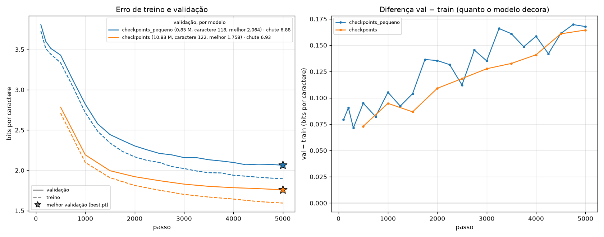
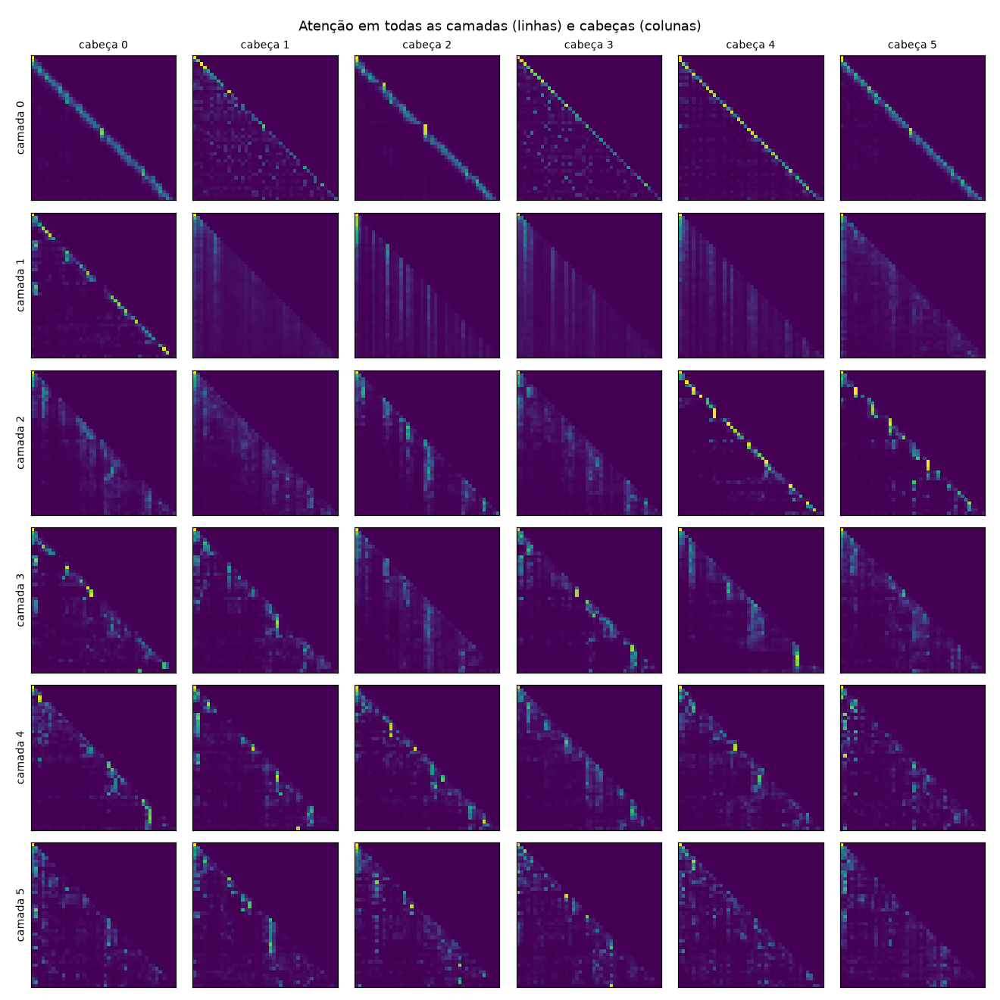
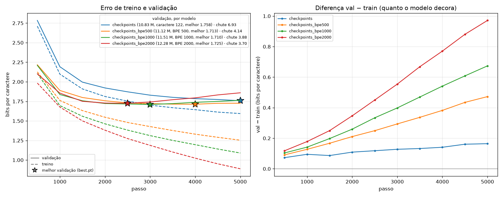

# machado-gpt — Gerador de texto no estilo de Machado de Assis

Um transformer GPT minimalista, escrito do zero em PyTorch, treinado em 11 obras
de Machado de Assis para gerar novos textos no estilo do autor.

> Capitu n'um companheiro de palavras cabeças, e, antes de apenas alheias.
> Pedia esquecer o padre Luiz Garcia que se deixasse ao meu pae, mas tinha um
> olhar de sentimento, alguma cousa que os tres annos, um manuscripto…
>
> — texto gerado pelo modelo de 10,8 M de parâmetros (`--temperature 0.7 --top_k 20`)

O projeto é **didático**: a ideia é entender na prática cada componente de um
transformer, seguindo a aula
["Let's build GPT from scratch"](https://www.youtube.com/watch?v=kCc8FmEb1nY)
de Andrej Karpathy. Não usamos frameworks de alto nível (HuggingFace, Keras etc.).

## Arquitetura

- Tokenização character-level (um token = um caractere), ou BPE implementado do
  zero (pedaços de palavra aprendidos do corpus), como opção
- Embedding de tokens + positional encoding
- N blocos de transformer, cada um com:
  - Multi-head self-attention
  - Feed-forward (MLP)
  - Layer normalization
- Head de linguagem (projeção para o vocabulário)

## Estrutura

```
machado-gpt/
├── data/
│   ├── raw/                    # cache dos .txt baixados do Gutenberg (ignorado pelo git)
│   ├── tokenizers/             # cache dos BPEs treinados (ignorado pelo git)
│   └── dataset.txt             # corpus limpo usado no treino
├── src/
│   ├── collect.py              # download e limpeza das obras
│   ├── data.py                 # tokenizador de caractere, split treino/validação e batches
│   ├── bpe.py                  # tokenizador BPE
│   ├── model.py                # definição do modelo GPT
│   ├── train.py                # loop de treinamento
│   ├── generate.py             # geração de texto a partir de um prompt
│   ├── plot_loss.py            # curvas de aprendizado (em bits por caractere)
│   └── visualize_attention.py  # heatmaps dos pesos de atenção
├── tests/                      # testes automáticos (pytest)
├── figures/                    # figuras geradas pelos scripts de análise
├── checkpoints/                # modelos treinados (ignorado pelo git)
├── requirements.txt
├── requirements-dev.txt        # dependências para rodar os testes
├── pytest.ini
└── README.md
```

## Instalação

Requer Python 3.11+.

```bash
python -m venv .venv
# Windows
.venv\Scripts\activate
# Linux/macOS
source .venv/bin/activate

pip install -r requirements.txt
```

Para rodar os testes automáticos (tokenizadores, separação dos dados, modelo e
funções do treino):

```bash
pip install -r requirements-dev.txt
python -m pytest
```

## Como usar

Todos os comandos são rodados a partir da raiz do projeto.

### 1. Coleta

```bash
python src/collect.py
```

Baixa as obras do Gutenberg, remove cabeçalho e rodapé de licença, junta as
linhas de cada parágrafo e salva `data/dataset.txt`. O texto bruto fica em cache
em `data/raw/`; rodando de novo, as obras já baixadas não são baixadas outra vez.

Para inspecionar o tokenizador, a divisão treino/validação e um batch de exemplo:

```bash
python src/data.py
```

### 2. Treino

```bash
python src/train.py
```

Com os padrões (5000 passos), leva cerca de 80 minutos numa CPU i5 de 13ª
geração. A cada 250 passos o script mostra a loss de treino e validação (também
em bits por caractere), o tempo restante e uma amostra de texto. Tudo é salvo em
`checkpoints/`, ou na pasta indicada por `--out_dir`:

| Arquivo          | Conteúdo                                              |
|------------------|-------------------------------------------------------|
| `best.pt`        | modelo com a menor val loss (usado na geração)        |
| `last.pt`        | estado mais recente, para retomar o treino            |
| `tokenizer.json` | vocabulário usado no treino (caractere ou BPE)        |
| `train_log.csv`  | loss e bits por caractere de treino/validação a cada avaliação |

Opções úteis:

```bash
# teste rápido
python src/train.py --max_iters 200 --eval_interval 100

# mudar a arquitetura ou o treino
python src/train.py --n_layer 6 --n_embd 192 --n_head 6 --learning_rate 1e-3
```

Rodar `python src/train.py` sem `--resume` começa do zero e sobrescreve os
checkpoints existentes.

Para o modelo maior (configuração final da aula, ~10,8 M de parâmetros), use
uma GPU. Num notebook do Kaggle ou do Colab, a partir da raiz do projeto:

```bash
python -u src/train.py --n_embd 384 --n_head 6 --n_layer 6 --dropout 0.2 \
    --batch_size 64 --max_iters 5000 --eval_interval 500 --eval_iters 100
```

Numa GPU P100 do Kaggle, isso levou cerca de 50 minutos.

#### Treino com BPE

Por padrão, cada token é um caractere. Com `--tokenizer bpe`, o texto é cortado
em pedaços de palavra aprendidos do próprio corpus pelo algoritmo BPE
(`src/bpe.py`): ` que`, `ão`, ` perguntou`... Com o mesmo `block_size`, o modelo
enxerga mais texto, porque cada token vale ~2 a 3 caracteres.

```bash
python src/train.py --tokenizer bpe --vocab_size 1000 --out_dir checkpoints_bpe1000
```

- `--vocab_size` é o tamanho **total** do vocabulário (caracteres + fusões).
- O BPE é treinado só com o texto de treino (as fusões nunca "veem" a
  validação) e fica em cache em `data/tokenizers/`. Treiná-lo leva de segundos
  a poucos minutos, só na primeira vez.
- `--out_dir` separa os checkpoints de cada experimento. Sem ele, o treino
  sobrescreve `checkpoints/`.
- `--tie_weights` faz a `lm_head` usar a mesma matriz do embedding de tokens
  (como no GPT-2), economizando `vocab_size × n_embd` parâmetros.

A loss é o erro **por token**, então não dá para comparar a loss de um modelo
BPE com a de um modelo de caractere. Para isso, o treino também mostra o erro
em **bits por caractere**: `loss ÷ (caracteres por token) ÷ ln 2`. Para o
tokenizador de caractere, é só a loss ÷ ln 2.

Experimento de tamanho do vocabulário (na GPU, mudando só o vocabulário):

```bash
for V in 500 1000 2000; do
  python -u src/train.py --tokenizer bpe --vocab_size $V --out_dir checkpoints_bpe$V \
      --n_embd 384 --n_head 6 --n_layer 6 --dropout 0.2 \
      --batch_size 64 --max_iters 5000 --eval_interval 500 --eval_iters 100
done
python src/plot_loss.py --runs checkpoints checkpoints_bpe500 checkpoints_bpe1000 checkpoints_bpe2000 \
    --output figures/bpe_vocab.png
```

Numa GPU T4 do Kaggle, cada rodada levou cerca de 46 minutos. Os resultados
estão na seção [Experimento: tokenizador BPE](#experimento-tokenizador-bpe).

### 3. Retomada

Aperte **Ctrl+C** a qualquer momento: o estado atual é salvo em `last.pt`. Para
continuar de onde parou:

```bash
python src/train.py --resume
```

A arquitetura e o tokenizador vêm sempre do checkpoint; `--max_iters` pode ser
aumentado para treinar por mais passos. Se o treino usou `--out_dir`, passe a
mesma pasta: `python src/train.py --resume --out_dir checkpoints_bpe1000`.

### 4. Geração

```bash
python src/generate.py --prompt "Capitu"
```

O texto aparece token por token (streaming): um caractere por vez no modelo de
caractere, um pedaço de palavra por vez num modelo BPE. Ctrl+C interrompe a
geração. Parâmetros de amostragem:

| Parâmetro          | Padrão          | Efeito                                                   |
|--------------------|-----------------|----------------------------------------------------------|
| `--prompt`         | `"\n"`          | texto inicial (`\n` vira quebra de linha)                |
| `--max_new_tokens` | 500             | quantos tokens gerar                                     |
| `--temperature`    | 0.8             | < 1: mais conservador; > 1: mais criativo e com erros    |
| `--top_k`          | nenhum          | sorteia só entre os k tokens mais prováveis              |
| `--num_samples`    | 1               | quantas gerações independentes                           |
| `--seed`           | nenhum          | fixa o resultado (reprodutível)                          |
| `--checkpoint`     | `checkpoints/best.pt` | checkpoint a usar                                  |

Exemplos:

```bash
# conservador e focado
python src/generate.py --prompt "Capitu" --temperature 0.5 --top_k 10

# mais ousado
python src/generate.py --prompt "Capitu" --temperature 1.3

# três variações do mesmo início, reprodutíveis
python src/generate.py --prompt "Era uma vez" --num_samples 3 --seed 42

# texto longo a partir do estado do último passo de treino
python src/generate.py --checkpoint checkpoints/last.pt --max_new_tokens 2000
```

O prompt só pode conter caracteres que aparecem nas obras (emojis, por exemplo,
não funcionam).

### 5. Análise dos modelos

Dois scripts geram figuras em `figures/` (requerem `matplotlib`):

```bash
# curvas de aprendizado (treino, validação e a diferença entre elas)
python src/plot_loss.py
python src/plot_loss.py --runs checkpoints_pequeno checkpoints --output figures/loss_curves.png

# pesos de atenção de cada cabeça (padrão: modelo em checkpoints/, última camada)
python src/visualize_attention.py
python src/visualize_attention.py --layer 0
python src/visualize_attention.py --checkpoint checkpoints_pequeno/best.pt --text "Era uma vez"
```

- **`plot_loss.py`** lê o `train_log.csv` e o `best.pt` de cada pasta e plota o
  erro de treino e validação por passo, em **bits por caractere**, para que
  modelos de caractere e de BPE fiquem na mesma unidade (com o erro de chute
  aleatório como referência), e a diferença val − train, que indica
  overfitting. No terminal, mostra uma tabela com parâmetros, tokenizador,
  caracteres por token, passos, caracteres vistos no treino e os erros finais.
- **`visualize_attention.py`** roda o modelo sobre um texto curto (até ~60
  tokens, para os rótulos ficarem legíveis) e salva um heatmap por cabeça da
  camada escolhida (`figures/attention_layer{N}.png`) e uma visão geral de
  todas as camadas × cabeças (`figures/attention_overview.png`, sobrescrita a
  cada execução). Os rótulos são os tokens do modelo: caracteres, ou pedaços
  de palavra num modelo BPE. No terminal, lista os tokens que mais recebem
  atenção em algumas posições do texto.

## Resultados

### Modelos de caractere

Foram treinados dois modelos, ambos por 5000 passos:

| Modelo  | Parâmetros | Arquitetura (n_embd / cabeças / camadas) | Dados    | Hardware   | Melhor val loss | Bits por caractere |
|---------|-----------:|------------------------------------------|----------|------------|----------------:|-------------------:|
| Pequeno |     0,85 M | 128 / 4 / 4, dropout 0.1, batch 32       | 5 obras  | CPU, ~75 min | 1,4304 | 2,064 |
| Grande  |    10,8 M  | 384 / 6 / 6, dropout 0.2, batch 64       | 11 obras | GPU, ~50 min | 1,2188 | 1,758 |

Para comparação, um modelo que chuta ao acaso tem loss ln(vocab_size) ≈ 4,8, ou
~6,9 bits por caractere. Os dois modelos usam o tokenizador de caractere.
O modelo grande escreve quase só palavras reais, na grafia da época, e frases
curtas gramaticais, mas ainda sem sentido entre as frases: é o limite esperado
de um modelo character-level desse tamanho.



Pesos de atenção do modelo grande para o texto
`--Capitu, que é isso? perguntou José Dias.` Na primeira camada, as cabeças
capturam padrões locais (como o caractere anterior); nas últimas, relações mais
longas (como o início da palavra atual):



| Figura | Conteúdo |
|--------|----------|
| [`attention_layer0.png`](figures/attention_layer0.png) | modelo grande, primeira camada |
| [`attention_layer5.png`](figures/attention_layer5.png) | modelo grande, última camada |
| [`attention_layer3.png`](figures/attention_layer3.png) | modelo pequeno, última camada |

### Experimento: tokenizador BPE

O modelo grande foi treinado de novo três vezes, mudando **só o tokenizador**:
BPE com vocabulário de 500, 1.000 e 2.000 tokens. Arquitetura, batch, learning
rate, número de passos, seed e conjunto de validação foram os mesmos do modelo
grande de caractere. Como a loss de modelos com tokenizadores diferentes não é
comparável, a comparação é feita em **bits por caractere** (quanto menor, melhor).

| Tokenizador | Caracteres por token | Parâmetros | Melhor validação (bits/caractere) | Passo do melhor | Val − train nesse passo |
|-------------|---------------------:|-----------:|----------------------------------:|----------------:|------------------------:|
| Caractere (122) | 1,00 | 10,83 M | 1,758 | 5000 | 0,16 |
| BPE 500     | 2,17 | 11,12 M | 1,713 | 4000 | 0,38 |
| **BPE 1000** | 2,57 | 11,51 M | **1,710** | 3000 | 0,40 |
| BPE 2000    | 2,96 | 12,28 M | 1,725 | 2500 | 0,45 |



O que o experimento mostrou:

- **Os três vocabulários BPE superaram o tokenizador de caractere.** O melhor
  (1.000 tokens) erra 0,048 bit a menos por caractere, uma melhora de ~2,7%.
- **500 e 1.000 empataram:** a diferença entre eles (0,002) é do tamanho do
  ruído da medição. **2.000 já foi pior**, mesmo comprimindo mais o texto: com
  um corpus pequeno, um vocabulário grande demais tem muitos tokens raros, mal
  treinados.
- **O BPE decora o texto muito mais rápido.** Todos os modelos treinaram 5000
  passos de 64 × 256 tokens, mas o texto de treino tem menos tokens quanto
  maior o vocabulário. Em 5000 passos, o modelo de caractere passou ~25 vezes
  pelo texto de treino; os de BPE, de ~55 (500) a ~76 vezes (2.000). Por isso
  a validação deles atinge o mínimo cedo (as estrelas na figura) e depois
  volta a subir, enquanto a diferença val − train dispara. O `best.pt` guarda
  cada modelo no seu melhor ponto, antes do overfitting.
- **Nos melhores checkpoints, nenhum modelo copia o treino.** No teste de
  memorização (10 textos gerados de 500 caracteres por modelo), o maior trecho
  idêntico ao texto de treino teve no máximo 23 a 34 caracteres, e no máximo
  0,7% do texto gerado estava em trechos idênticos de 30 caracteres ou mais. Em
  trechos reais de Machado tirados da validação, esses números chegam a 52
  caracteres e 3%: o próprio autor se repete mais.

Limitações desta comparação:

- O modelo de caractere ainda estava melhorando no passo 5000; com mais passos,
  ele poderia diminuir parte da diferença.
- Cada configuração foi treinada uma única vez (uma seed), então diferenças
  pequenas, como entre 500 e 1.000, não são conclusivas.
- O melhor vocabulário foi escolhido pelo mesmo conjunto de validação em que o
  resultado é reportado, o que deixa o número levemente otimista. Um conjunto
  de teste separado daria uma medida mais rigorosa.

Próximos experimentos possíveis: combater o overfitting do BPE com
`--tie_weights` (menos parâmetros no vocabulário), mais dropout ou menos passos.

Os checkpoints não estão no repositório (o `best.pt` do modelo grande tem
~139 MB). Para gerar texto, treine um modelo com `src/train.py` ou baixe o
`best.pt` e o `tokenizer.json` da página de Releases e coloque-os em
`checkpoints/`.

## Hiperparâmetros padrão

| Parâmetro       | Valor | Descrição                              |
|-----------------|-------|----------------------------------------|
| `block_size`    | 256   | Tamanho do contexto (em tokens)        |
| `n_embd`        | 128   | Dimensão dos embeddings                |
| `n_head`        | 4     | Número de cabeças de atenção           |
| `n_layer`       | 4     | Número de blocos de transformer        |
| `dropout`       | 0.1   | Taxa de dropout                        |
| `batch_size`    | 32    | Tamanho do batch                       |
| `learning_rate` | 3e-4  | Taxa de aprendizado                    |

## Dataset

Obras de Machado de Assis em domínio público, do
[Project Gutenberg](https://www.gutenberg.org):

| Obra                             | Caracteres |
|----------------------------------|-----------:|
| Dom Casmurro                     |    378.928 |
| Memórias Póstumas de Brás Cubas  |    364.903 |
| Quincas Borba                    |    453.033 |
| Esaú e Jacó                      |    414.921 |
| Papéis Avulsos (contém O Alienista) | 322.576 |
| Helena                           |    336.180 |
| Memorial de Aires                |    289.033 |
| Iaiá Garcia                      |    330.227 |
| A Mão e a Luva                   |    203.671 |
| Histórias sem Data               |    299.536 |
| Relíquias de Casa Velha          |    278.349 |

No total são cerca de 3,67 milhões de caracteres, com um vocabulário de 122
caracteres únicos. A validação usa os últimos 10% de cada obra.

Para adicionar outra obra, inclua o título e a URL do `.txt` na constante
`WORKS`, no topo de `src/collect.py`.

O `collect.py` remove o cabeçalho e o rodapé de licença do Gutenberg e junta as
linhas de cada parágrafo numa só. O travessão "—", usado em algumas edições, é
convertido para "--", a forma usada no resto do corpus. As edições são antigas e usam a grafia da época
(ex.: "Braz", "theoria"), que o modelo vai aprender junto com o estilo.
